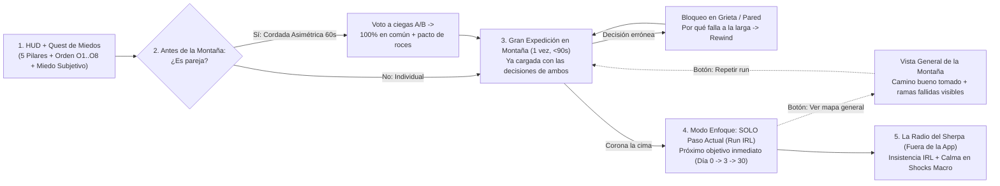

# Biblia Final V1: *Sherpa Basecamp × Living Timeline*

> **Documento maestro unificado (Rama `main`)**  
> **Fusión de:** `PROPUESTA_SHERPA_BASECAMP.md` (`main`) + `IDEA_BITLIFE.md` (`bitlife`)  
> **Objetivo:** Resolver el **Paso 3 del asesor** (*Bring the plan to life*) transformando el PDF estático de 22 páginas en una **expedición de montaña interactiva (Run Simulada <90s)** conectada a una **línea de vida real proactiva (Run IRL + La Radio del Sherpa)**, fundamentada en economía conductual y 100% respaldada por los datos reales de Sherpas (`cases/`), sin inventar números.

---

## 1. El punto de partida: por qué falla el formato actual y las 4 pistas ocultas

Sherpas ya resuelve la recogida de datos y el cálculo financiero. Nuestro foco exclusivo es lograr que la familia **entienda su plan, supere el bloqueo emocional y pase a la acción** (evitando hacer un mero dashboard pasivo o un chat genérico).

Al auditar los `report.pdf`, los JSON (`financial-health.json`, `investment-analysis.json`) y `persona.md`, detectamos **4 pistas clave**:

1. **El fallo emocional del PDF actual (`report.pdf`):** Es un documento corporativo de 22 páginas basado en una proyección determinista limpia (sin turbulencias ni fricciones). Por eso quien tiene un score alto (Samantha, `82/100`) no ve que se queda sin liquidez a los 74 años, y quien tiene un score crítico (Michael, `26/100`) se bloquea y cierra el informe. Irónicamente, la empresa se llama **Sherpas** y la portada del PDF ya dibuja curvas topográficas de montaña.
2. **El vacío de datos emocionales y subjetivos en `persona.md`:** `persona.md` trae oro psicológico (`D4a/b/c` riesgo declarado vs. real `MISALIGNED`, `D5: DUAL` parejas que deciden por separado, `D6` ancla motivacional y tensiones `T1..T5`), pero el campo **`Subjective concerns`** aparece vacío (*"None recorded"*). El plan calcula números, pero nadie ha preguntado a la familia qué miedo real le quita el sueño.
3. **Todos los impactos y tormentas reales ya existen en el JSON (cero cálculos inventados):**
   - `projections.yearly` aporta la evolución real año a año hasta los 91 años (`investable_assets`, `net_worth`, `total_debts`).
   - `score.top_moves` y `combined_moves` ya calculan cuánto sube el score con cada acción concreta.
   - `savingsWaterfall` ordena los pasos óptimos de ahorro/deuda.
   - `analysis.events` y `perEventDrawdowns` documentan **11 shocks reales de mercado (2023–2026)** y exactamente cómo aguantó y se recuperó la cartera de cada familia.
4. **Un plan a 30 años no se abre todos los días:** Las familias no miran un dashboard financiero a diario. El verdadero reto es generar claridad y compromiso en **90 segundos el Día 1**, y salir **fuera de la aplicación** para acompañar con seguridad en el Día 3, el Día 30, las fechas críticas del calendario y las caídas de mercado.

---

## 2. Arquitectura unificada: Flujo en orden estricto (`Parejas/Miedos → Montaña → Paso Actual IRL`)

### Paso previo obligatorio — Quest de Miedos y Cordada Asimétrica (ANTES de entrar a la Montaña)
Ataca directamente los datos emocionales que faltan en el plan actual (`Subjective concerns` vacío + parejas `D5: DUAL` con riesgo `MISALIGNED`). **Esta fase ocurre siempre antes de la primera *Run* en la montaña**, precisamente para que el simulador ya tenga en cuenta las decisiones y miedos de ambos miembros al empezar a escalar:

1. **Quest inicial de miedos (15–30s):** Cada persona ordena las preocupaciones objetivas de `persona.md` (`O1..O8`) e indica **qué le quita el sueño hoy**, alimentando el relato y el *Advisor Brief*.
2. **Cordada Asimétrica para parejas (Weah y Johnson):**
   - Cada titular (ej. Timothy y Melanie, o Daniel y Emily) entra por separado **a ciegas en 60 segundos** antes de ver la montaña: marca sus miedos reales y vota sus prioridades de decisión sin ver lo que elige su pareja.
   - Al cruzar ambas respuestas, la app muestra primero **"En qué coincidís al 100%"** (su ancla motivacional compartida, p. ej. proteger a los hijos) y aísla **únicamente los 1–2 puntos de choque**, proponiendo un **punto medio realista** con su flujo de caja.
   - **Entrada a la montaña ya alineada:** Con las preferencias de A y B registradas, la expedición arranca mostrando ya sus colores y teniendo en cuenta lo que decidió cada uno (si ambos coinciden en opciones válidas, suben juntos por el tronco; si alguno se desvía a una opción errónea, se bifurca su rama de color para ver juntos la consecuencia antes de hacer *Rewind*).

### La Gran Expedición — La Montaña de Decisiones (*Run Simulada*, se hace una sola vez)
Sustituye el PDF de 22 páginas por una **expedición topográfica móvil (<90s)** sobre la curva real de `projections.yearly` hasta los 91 años, dividida en **campamentos base**. Está pensada como una **experiencia inicial completa de una sola vez** (con opción de reabrirla más adelante si el usuario quiere volver a simular o recuperar la visión global):

- **HUD de 5 Pilares + Toggle `Plain ↔ Math` permanente:** En lugar de asustar con un rojo `26/100`, muestra las 5 barras reales de `score.pillars` (*Savings & cash flow*, *Debt*, *Investments*, *Liquidity*, *Protection*) y reconoce fortalezas reales. En cualquier nodo, **`Plain`** traduce porcentajes a impacto cotidiano (dólares/año o meses de colchón) y **`Math`** despliega las métricas exactas del JSON (`top_moves`, `key_metrics`, `savingsWaterfall`, `taxDragAnalysis`).
- **Previsualización de tendencia + Efecto IKEA:** En cada campamento, antes de confirmar una decisión, el usuario ve visualmente hacia dónde apuntan las líneas de su ruta (subida hacia la cima, estancamiento o desvío) según los `top_moves` reales de Sherpas. Al participar en las decisiones, siente el plan como propio.
- **Bloqueo en "Grieta / Pared" (no te deja seguir) + *Rewind*:** Si el usuario elige una ruta errónea (o mantiene la inercia actual) y avanza en el tiempo, nace una **bifurcación visual hacia el punto donde el plan falla** y **la montaña le bloquea el paso hacia la cima**:
  - *En casos que agotan liquidez (Michael en 2075, Samantha en 2053):* salta al año exacto donde `investable_assets` cae en negativo (`-$38,276` a los 86 años; `-$227,414` a los 74 años aunque su score inicial fuera `82`).
  - *En casos que no quiebran en `yearly` (Weah y Johnson):* choca contra un muro de fuga de dinero y desprotección real (`$3,240/año` quemados en intereses al 18% en Weah; tarjeta al 24.9% + `0/20` en protección con `-$2.35M` de brecha de seguro en Johnson; score estancado en `60`/`52` en lugar de subir a `78`/`60`).
  - Un desplegable explica **por qué a la larga es mala idea** cruzando `key_metrics.facts` y `persona.md` (`Tensions T1..T5`), y solo permite hacer **`Rewind`** al campamento anterior para elegir el desvío viable y alcanzar la cima.
  - *Eventos sin alternativa precalculada* (ej. compra de vivienda en 2027/2030): no inventan cifras; muestran el impacto real en `yearly` y permiten enviar la duda directa al **Advisor Brief**.

### Después de la Cima — Modo Enfoque (*Run IRL*: solo tu próximo paso) + La Radio del Sherpa
Una vez terminada la gran expedición inicial, **el usuario no tiene que volver a recorrer toda la montaña ni tragarse todo el juego cada vez que entra**. La app cambia automáticamente a una **vista de enfoque en el paso actual**:

1. **Solo ves tu paso actual en la montaña (`Step 1` / Próximo Objetivo Inmediato):** En la pantalla principal ves únicamente en qué campamento estás hoy y **un solo objetivo inmediato de 3 minutos** (extraído de `savingsWaterfall`, y repartido en parejas por *Owner A / Owner B*), eliminando todo el ruido del resto del plan a 30 años para que te centres solo en ejecutar eso.
2. **Vista general de tu montaña + botón separado para repetir la run:** Desde el modo enfoque siempre hay un botón (*"Ver visión general de la montaña"*) que **no te reinicia el juego**, sino que te muestra tu mapa ya completado: **el camino correcto que elegiste hacia la cima y las ramas donde fallaste visibles como recordatorio** de por qué descartaste esas opciones. Dentro de esa vista general existe un **segundo botón explícito (*"Repetir expedición"*)** por si quieres volver a jugar y probar otro camino desde cero.
3. **La *Run IRL* donde el tiempo real avanza siempre:** Una línea temporal real (`Día 0 → Día 3 → Día 14 → Día 30 → Fechas de transición reales`). Los días avanzan cumplan o no: si llega el Día 3 o el Día 30 y no han marcado el paso actual, la tarea se arrastra como pendiente mostrando el **coste real de la inercia** (intereses devengados, días sin cobertura) y al completarla se desbloquea el siguiente objetivo inmediato.
4. **La Radio del Sherpa (Notificaciones proactivas fuera de la app + `.ics`):**
   - **Recordatorios de hito e insistencia:** Avisan antes de fechas reales del caso (ej. matrícula de agosto, compra de vivienda en 2027/2030) y en Día 3 / Día 30 para resolver dudas en 30 segundos, con exportación directa al calendario (`.ics`).
   - **Alertas de calma y refuerzo ante caídas de bolsa (`analysis.events`):** Cuando ocurre un evento macro fuera de su control (caída bursátil, subida de tipos, pico de volatilidad), reciben una notificación proactiva que cruza el susto actual con los **11 shocks históricos reales** de su cartera en `investment-analysis.json`: les recuerda con datos reales cómo **con sus mismos *assets* y estrategia ya aguantaron las caídas del año pasado (como los aranceles de abril de 2025 o la corrección de agosto de 2024) y se recuperaron en semanas**, reforzando su seguridad y manteniendo vivo el plan.

---

## 3. Respuesta directa a los 11 problemas detectados por Sherpas (`README.md`)

| # | Problema actual en Sherpas | Cómo lo resuelve *Sherpa Basecamp × Living Timeline* |
| :-: | :--- | :--- |
| **1** | No ven cómo una decisión hoy cambia su futuro. | Montaña topográfica (`projections.yearly`) con bloqueo en grieta si fallas y `Rewind` inmediato. |
| **2** | Cifras grandes y porcentajes sin sentido (`"$2.37M"`). | Toggle permanente **`Plain ↔ Math`** (impacto cotidiano vs. cifras exactas del asesor). |
| **3** | Un buen *score* oculta un problema grave (Samantha: `82`). | La montaña desvela el abismo real en **2053 (edad 74, `-$227,414`)** pese al `82` inicial. |
| **4** | Responde a lo calculable, no al miedo que les quita el sueño. | **Quest inicial de miedos** (`O1..O8` + `Subjective concerns`) que ordena el relato y nutre el *Advisor Brief*. |
| **5** | Familias ocupadas no leen 22 páginas; usan móvil a ratos. | Expedición inicial de **<90 segundos** (1 sola vez) y después vista enfocada **solo en el paso actual** + micro-notificaciones. |
| **6** | Malas noticias paralizan (Michael: `26 critical`). | HUD con 5 pilares que reconoce su ahorro (`23.9%`) y demuestra en el tronco que puede subir `26 → 62`. |
| **7** | Muerte y seguros se evitan por incomodidad. | Protección integrada como campamento visual de escudo familiar (`52 → 60` en Johnson). |
| **8** | Parejas con distinto riesgo que no acuerdan (Weah / Johnson). | **Cordada Asimétrica (60s a ciegas ANTES de la montaña)** + ramas por color + punto medio sin reproches. |
| **9** | Dudas en Día 3 / Día 30 cuando ya olvidaron la reunión. | **Run IRL** viva + notificaciones de insistencia que resuelven bloqueos en 30s. |
| **10** | El plan llega fuera de las fechas reales de acción. | Hitos anclados a fechas reales (`chartGoals` / *Transition alerts*) + `.ics` + alertas de mercado IRL. |
| **11** | Demasiadas opciones sin Primer Paso claro ni seguimiento. | Tras la cima, **solo ves tu próximo objetivo inmediato** (`Step 1` de 3 min), con acceso al mapa general resuelto (camino bueno + ramas fallidas) y botón aparte para repetir la run. |

---

## 4. Mapa verificado de datos reales por caso (`cases/` — Cero números inventados)

| Caso | Perfil y Score | Campamentos, Bloqueo en Montaña y Palancas (`top_moves`) | *Run IRL* (Día 0 / 3 / 30) y Shocks (`analysis.events`) |
| :--- | :--- | :--- | :--- |
| **Michael Carter** (37, soltero, Austin) | Score **`26`** (`critical`) Cash flow `0/25`, Liquidity `4/20`, Protection `4/20` | • **2026:** Umbrella `$1M` (`26→31`), subir growth `74%→88%` (`26→31`). • **2027:** Casa `$550k` (`investable_assets` cae de `$178,717` a `$81,172`, `0 meses` de caja). • **2047:** Jubilarse a los 58 (`26→62` bajando retiro a `$10,300/año`). • **Bloqueo en grieta:** **2075 (edad 86)** con `-$38,276` líquidos. | • **Día 0/3:** Liquidar Amex `$3,500` (20% APR) con los `$27,000` de banco. • **Día 30:** Subir 401(k) (`+$7,500` de margen = `$1,800/año` ahorro fiscal) y revisar `JNK` (`$527/año` *tax drag*). • **Shock macro:** Caída máx. `-10.2%` recuperada en `62 días`. |
| **Samantha Lewis** (47, 2 hijos: 18 y 16) | Score **`82`** (`strong`) Trampa: `$0` en cuentas de jubilación | • **2026:** Seguro de hogar (`82→84`), bajar concentración en `VTI` de `39%→25%` (`82→83`), ajustar growth `85%→80%` (`82→83`). • **2027–2030:** Universidad (`$50k` por hijo) + casa `$500k` en 2030. • **Bloqueo en grieta:** **2053 (edad 74)** con `-$227,414` líquidos (`net_worth` negativo en 2070). | • **Día 0/3:** Confirmar póliza de hogar y del Porsche Cayenne. • **Día 30:** Aportar `$24,500` de margen en 401(k) + `$4,400` HSA y corregir `$3,032/año` de *tax drag* en cuenta sujeta a impuestos. |
| **Timothy & Melanie Weah** (40 y 38, 2 hijos: 6 y 3) | Score **`60`** (`vulnerable`) Pareja `DUAL`: *Growth* vs. *Moderate* | • **Cordada (2026):** Liquidar tarjeta `$18k` al 18% (`60→62`), seguro vida `$1.1M` + umbrella `$1M`. **Juntos (`combined_moves`) suben `60 → 78`.** • **Bloqueo / Muro:** No quiebran en `yearly` (`$16.1M` en 2079), pero chocan con **`$3,240/año` quemados al 18%** frente a `$150,800` al `0.09%`, más el riesgo `UPRO` (3x). | • **Owner Melanie (Día 3):** Liquidar los `$18,000` al 18% APR usando exceso de efectivo. • **Owner Timothy (Día 14/30):** Reducir exposición apalancada `UPRO` y activar 401(k) (`$5,760/año` ahorro fiscal) + 529. • **Shock macro:** Aviso de volatilidad amplificada 3x en `UPRO` usando shocks 2023–2026. |
| **Daniel & Emily Johnson** (44 y 42, 2 hijos: 11 y 9) | Score **`52`** (`vulnerable`) Protection `0/20`, caja `1.4 meses` | • **Cordada (2026):** Seguro vida `+$1.166M` (`52→57`), umbrella `$1M` (`52→56`), redirigir `$15,032/año` (`52→55`). **Combinados suben `52 → 60`.** • **Bloqueo / Muro:** Desprotección familiar (`-$2.35M` brecha total de vida) + tarjeta de `$18,000` al **24.9% APR** con `$0` aportados al 401(k). | • **Check conjunto (Día 3):** Frenar desvío a brokerage/529 para atacar tarjeta al 24.9% y pedir cotización de seguro de vida. • **Día 30:** Activar aportación a 401(k) (`$11,760/año` de ahorro fiscal potencial). |

---

## Apéndice A: Por qué el núcleo del proyecto es resolver el miedo y gestionar las emociones

Los números por sí solos casi nunca hacen que una familia actúe; lo que paraliza o provoca errores financieros irreversibles es **el miedo**. Un PDF de 22 páginas responde a la lógica matemática, pero fracasa porque ignora el factor humano:

1. **De la parálisis a la agencia humana (*Efecto IKEA*):**
   Ver un `26/100` o un déficit millonario en un informe estático genera rechazo (*"esto no tiene arreglo, mejor no miro"*). Cuando la persona participa activamente en la montaña eligiendo sus propios pasos, chocando contra las consecuencias en una grieta segura y haciendo *Rewind* para encontrar la cima, **siente control sobre su futuro**. Valoramos y ejecutamos mucho más un plan que hemos construido que una lista de órdenes impuestas.
2. **Desactivar el miedo y la culpa en pareja:**
   En muchos hogares se evita hablar de dinero por miedo al conflicto (*uno arrastra la tarjeta, el otro ahorra; uno busca crecimiento, el otro seguridad*). La **Cordada Asimétrica** protege el espacio emocional de cada miembro: les deja expresar sus miedos a ciegas sin sentirse juzgados en el acto, visibiliza primero lo que comparten (proteger a los hijos) y transforma una discusión emocional en un acuerdo práctico sobre su flujo de caja.
3. **Contener el pánico ante sucesos fuera de nuestro control:**
   Cuando cae la bolsa o llegan titulares alarmistas, el miedo empuja a vender en el peor momento y abandonar el plan. **La Radio del Sherpa** actúa de forma proactiva justo en ese momento vulnerable como un ancla de seguridad: les recuerda con datos reales de `investment-analysis.json` que **el año pasado / en las caídas recientes (como los aranceles de abril de 2025 o la volatilidad de 2024–2026) ya pasaron por tormentas similares y, manteniendo sus *assets* y su estrategia, las aguantaron como campeones y se recuperaron**, reforzando su confianza en el plan actual de una forma dinámica que un PDF jamás puede lograr.

---

## Apéndice B: Fundamentación en Economía Conductual (*Behavioral Translation Engine*)

Cada mecánica del flujo está diseñada específicamente para neutralizar un sesgo cognitivo documentado en los 4 casos reales de Sherpas:

### B.1. Sesgos de Clasificación del Dinero (Por qué toman malas decisiones con sus cuentas)

| Sesgo Psicológico | Cómo sabotea al cliente en los casos de Sherpas | Qué mecánica de nuestra app lo desbloquea |
| :--- | :--- | :--- |
| **Contabilidad Mental** (*Mental Accounting* — R. Thaler) | Separan en "cajones mentales" ahorro intocable y deuda cara: **Weah** guarda `$150,800` al `0.09%` mientras paga `18%` en `$18,000`; **Johnson** ahorra `$26,000/año` mientras arrastra `$18,000` al `24.9%`. | **Bloqueo "Cubo Agujereado" + Desplegable de Flujo Neto:** Junta ambos cajones en una sola cifra (*"Tu efectivo rinde ~$135/año, pero tu tarjeta quema $3,240/año"*). |
| **Efecto Halo / Ceguera de Indicador Único** (*Single-Metric Fallacy & Halo Effect*) | Un score verde hace asumir que todo va bien: **Samantha** ve `82/100 (Strong)` e ignora que tiene `$0` para su jubilación. | **HUD desglosado + Grieta en 2053:** La montaña ignora el `82` y choca contra el precipicio real a los **74 años (`-$227,414`)**. |
| **Ilusión de Riqueza Inmobiliaria** (*House-Rich, Cash-Poor Illusion*) | Confunden `net_worth` con dinero líquido para vivir: **Michael** (`$2.57M` en 2075 pero `-$38,276` líquidos), **Samantha** (`$900k` en vivienda) y **Johnson** (`$750k` casa vs. `$190k` equity). | **Separación visual `Investable Assets` vs. `Net Worth`:** La montaña principal traza liquidez real utilizable, dejando claro cuándo el patrimonio es solo ladrillo ilíquido. |

### B.2. Sesgos Temporales (El choque entre el "Yo de hoy" y el "Yo del futuro")

| Sesgo Psicológico | Cómo sabotea al cliente en los casos de Sherpas | Qué mecánica de nuestra app lo desbloquea |
| :--- | :--- | :--- |
| **Descuento Hiperbólico / Sesgo del Presente** (*Present Bias*) | El deseo inmediato pesa más que el déficit lejano: **Michael** prioriza comprar casa de `$550k` en 2027 (dejando `0 meses` de caja) sin ver el choque con jubilarse a los 58. | **Bifurcación visual instantánea + Bloqueo:** Al elegir en `2026/2027`, la ruta en la montaña muestra en el mismo plano el impacto en `2047` y `2075`, eliminando la distancia temporal. |
| **Desconexión con el "Yo Futuro"** (*Future-Self Continuity Gap* — H. Hershfield) | El cerebro trata al yo de 85 años como a un extraño; cifras lejanas como `"$2.37M"` no generan emoción ni acción. | **Progreso en primera persona (`Age 37 → 58 → 86`) + `Plain ↔ Math`:** Traduce millones abstractos a años y meses reales de vida cubiertos. |
| **Falacia de Planificación y Costes Ocultos** (*Planning Fallacy & Hidden Cost Neglect*) | **Michael** compara `$2,800/mes` de alquiler con `$3,015/mes` de hipoteca ignorando `$5,665/año` de impuestos, `$2,832.50/año` de seguro y `$9,464` de cierre; **Samantha** planea otra compra de `$500k` en 2030. | **Desplegable del Campamento de Transición (2027 / 2030):** Antes de confirmar, desglosa el coste total real frente a la liquidez (`persona.md` *Transition alerts*). |

### B.3. Sesgos Emocionales y de Defensa (Por qué el cliente cierra el informe)

| Sesgo Psicológico | Cómo sabotea al cliente en los casos de Sherpas | Qué mecánica de nuestra app lo desbloquea |
| :--- | :--- | :--- |
| **Efecto Avestruz** (*Ostrich Effect*) | Evitar información que hace sentir fracasado: **Michael** ahorra el `23.9%` de su sueldo (`$43,000/año`), pero abrir con `26/100 Critical` en rojo le hace abandonar. | **Reframing Positivo + Ruta Viable hacia la Cima:** El HUD reconoce primero su esfuerzo de ahorro (`23.9%`) y demuestra que reordenando piezas sube `26 → 62`. |
| **Sesgo de Optimismo e Invulnerabilidad** (*Optimism Bias & Mortality Salience*) | Posponer seguros para no pensar en morir o sufrir una demanda: **Johnson** (`0/20` protección, `-$2.35M` brecha) y **Weah** (`-$1.1M` brecha, `$0` *umbrella*). | **Quest de Miedos + Campamento de Escudo Familiar:** Replantea la cobertura no como "hablar de muerte", sino como blindar el techo y futuro de los hijos (`52 → 60`). |
| **Priorización Emocional Invertida** (*Síndrome de la Mascarilla de Oxígeno*) | Priorizan por culpa la universidad de los hijos sobre su propia jubilación: **Johnson** mete `$8,000/año` al 529 y `$0` al 401(k) (perdiendo `$11,760/año` fiscales); **Samantha** compromete `$100k` con `$0` en retiro. | **Desplegable de Tensión (`T5` / `O1`) + Orden `savingsWaterfall`:** Explica por qué desatender el 401(k) traslada el problema a los hijos más adelante. |

### B.4. Sesgos de Acción, Inercia y Pareja (Por qué no hacen nada tras la reunión)

| Sesgo Psicológico | Cómo sabotea al cliente en los casos de Sherpas | Qué mecánica de nuestra app lo desbloquea |
| :--- | :--- | :--- |
| **Parálisis por Análisis y Sobrecarga** (*Choice Overload / Hick's Law*) | En **Weah** y **Johnson** (`T1`), 6 metas urgentes compiten por los mismos `$15,032/año`; ante demasiadas opciones, no hacen ninguna. | **Secuenciación en la *Run IRL*:** En lugar de 16 filas del *waterfall* de golpe, entrega **un único `Step 1` de 3 minutos en el Día 0** y libera los siguientes en Día 3 / Día 30. |
| **Sesgo de Statu Quo y Curva del Olvido** (*Status Quo Bias & Ebbinghaus Curve*) | A los 3 o 30 días la motivación desaparece y gana la fricción administrativa. | **Tiempo IRL implacable + Insistencia proactiva:** Los días avanzan aunque no actúen; las tareas vencidas arrastran el coste diario de la inercia y disparan nuevos avisos. |
| **Aversión a la Pérdida y Sesgo de Recencia** (*Loss Aversion & Recency Bias* — Kahneman & Tversky) | **Melanie Weah** teme invertir su efectivo (`$150k` al `0.09%`), mientras **Timothy** confía en exceso en su ETF apalancado 3x (`UPRO`) tras el último ciclo alcista. | **La Radio del Sherpa (`analysis.events`):** Compara cada caída actual con los **11 shocks históricos reales** (2023–2026), mostrando recuperación real (`62 días` en Michael) frente al riesgo real de un 3x. |
| **Veto Silencioso y Silos en Pareja** (*Couples Veto & Role Siloing*) | En **Weah** y **Johnson**, ellos son *Growth (4)* y ellas *Moderate (3)* (y en Johnson, Emily ahorra mientras Daniel carga las deudas); si el plan solo habla a uno, el otro lo frena. | **Cordada Asimétrica (ramas por color) + Reparto *Owner A / Owner B* en la *Run IRL*:** Visibiliza dónde coinciden, dónde se bifurca cada uno y asigna misiones reales según quién gestiona cada cuenta. |
