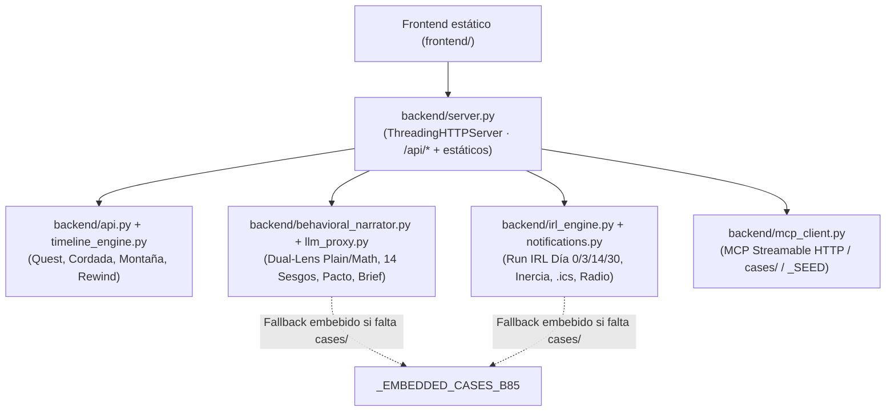

# Capacidades del Backend Unificado — Sherpa Basecamp x Run IRL

> **Estado (19-nov, versión de entrega):** 11 módulos en `backend/` + servidor HTTP unificado + entrada para Vercel (`api/index.py`). Los PR citados son históricos; todo está en `main`.  
> **Principio rector:** Cero números inventados ni inferencias fuera de fuente. Todas las cifras, hitos, sesgos y alertas proceden de los datos reales de los 4 hogares de Sherpas (`michael-carter`, `samantha-lewis`, `timothy-melanie-weah`, `daniel-emily-johnson`).

---

## 1. Resumen Ejecutivo y Arquitectura

El backend de **Sherpa Basecamp x Run IRL** está organizado bajo el directorio `backend/` como un **namespace package de Python 3 (sin `backend/__init__.py`)**, lo que permite desarrollar, probar e integrar cada subsistema en paralelo sin conflictos de importación ni de merge.



### Garantías transversales verificadas
- **Cero dependencias externas obligatorias:** El servidor unificado, el motor de montaña, el motor Run IRL, las notificaciones y el cliente proxy/MCP funcionan con la biblioteca estándar de Python 3 (con soporte opcional para `openai` SDK cuando está instalado).
- **Portabilidad total (sin `cases/` en disco ni claves en entorno):**
  - `backend/behavioral_narrator.py` y `backend/irl_engine.py` priorizan `cases_dir` explícito, `SHERPAS_CASES_DIR`, `CASES_DIR`, carpetas locales (`cases/`, `hackathon-upv-2026/cases`) y, en ausencia de archivos en disco, materializan automáticamente los 4 casos canónicos desde `_EMBEDDED_CASES_B85` en `sherpas_canonical_cases_v1` (consultando opcionalmente `backend.mcp_client.get_case` si existe `MCP_TOKEN`).
  - `backend/llm_proxy.py` entra automáticamente en modo *fallback* determinista si falta `TEAM_KEY`, si el presupuesto de `$50` USD está agotado o si el proxy remoto no responde.
- **Seguridad y control de datos:** Lectura de archivos JSON/Markdown con `encoding="utf-8-sig"`, enmascaramiento de secretos en `repr()`/respuestas, y validación estricta numérica (`verify_text_numbers_against_case`) para descartar cualquier enriquecimiento LLM que introduzca cifras no presentes en el caso.

---

## 2. Capacidades por Módulo

### 2.1. Conector MCP y Fallback (`backend/mcp_client.py` — PR #10)
- **Cliente:** `SherpasMCPClient` y funciones `list_cases()` / `get_case(case_id, section=None)`.
- **Protocolo:** HTTP Streamable JSON-RPC 2.0 contra `MCP_URL` (por defecto `https://mcp-hackathon.sherpaswealth.com/mcp`) autenticando con `MCP_TOKEN` (`Authorization: Bearer <token>`), con carga segura de `.env` (`load_env_file`) sin sobrescribir variables ya presentes.
- **Secciones soportadas:** `financial-health`, `investment-analysis` y `persona`.
- **Cadena de resiliencia:** MCP remoto → archivos locales en `cases/<case_id>/` (`SHERPAS_CASES_DIR` / `CASES_DIR` / `cases/`) → catálogo `_SEED` integrado para funcionamiento offline.

### 2.2. Motor Determinista de Montaña, Quest y Cordada (`backend/timeline_engine.py` + `backend/api.py` — PR #11)
- **Catálogo y normalización (`TimelineEngine`):**
  - `load_case(case_id)`, `list_cases()` y `overview(case_id, mode="plain"|"math")`.
  - Normaliza `published_score`, `points_shown_in_app`, `age_client` en `projections.yearly`, los 5 pilares canónicos (`Savings & cash flow`, `Debt`, `Investments`, `Liquidity`, `Protection`), `top_moves`, `combined_moves` y `combined_target_score`.
- **Máquina de estados de la expedición (`Expedition`):**
  - Flujo estricto de fases: `quest` → `cordada` (en hogares `DUAL`: `timothy-melanie-weah` y `daniel-emily-johnson`) → `mountain` → `summit`.
  - **Quest (`submit_quest`):** Registra el ranking de miedos (`O1..O8`) y el miedo subjetivo capturado del usuario (`Subjective concerns` vacío en `persona.md`).
  - **Cordada Asimétrica (`submit_vote`):** Votación a ciegas A/B (`blind_pending: true` hasta que votan ambos); al completarse los 2 votos revela coincidencias al 100% (ancla `D6` + miedos comunes), aísla fricciones, calcula el punto medio de flujo de caja y precarga los colores por miembro para la montaña.
  - **Montaña (`preview`, `decide`, `rewind`, `overview`, `restart`):**
    - Previsualiza el impacto de cada opción antes de confirmar.
    - Si una decisión falla, bloquea la expedición (`ActionBlockedError`, rama fallida con color del titular y explicación raíz `plain`/`math` + tensiones `T1..T5`) obligando a ejecutar `rewind()` para elegir la ruta viable.
    - Los hitos sin contrafactual precalculado (`transition_event`, como compra de vivienda 2027/2030) registran el impacto en `yearly` y permiten enviar la duda directa a `advisor_brief`.
    - `overview()` devuelve la vista general no destructiva (camino bueno + ramas fallidas) sin reiniciar la partida; `restart()` reinicia explícitamente desde `quest`.
- **Capa de servicio (`backend/api.py`):** `SessionStore` con bloqueo reentrante (`RLock`), `dispatch_request`, `create_wsgi_app`, `create_http_server` y `create_fastapi_app` opcional, devolviendo `409 Conflict` ante `PhaseOrderError`/`ActionBlockedError`, `404` ante `KeyError` y `400` ante `ValueError`.

### 2.3. Cliente AI Proxy Sherpas y Motor Conductual (`backend/llm_proxy.py` + `backend/behavioral_narrator.py` — PR #8)
- **Cliente AI Proxy (`LLMProxyClient`):**
  - Compatible con `openai` SDK cuando está instalado y con fallback nativo vía `urllib.request` contra `LLM_PROXY_URL` (`https://llm-hackathon.sherpaswealth.com/v1/chat/completions`), autenticando con `TEAM_KEY` (leída desde entorno o `.env`, nunca expuesta).
  - **Control de presupuesto (`get_key_info()` / `ensure_budget_available()`):** Consulta `GET /key/info`, parsea `info.spend` e `info.max_budget` (`$50` USD máx.) y bloquea o deriva a fallback si el presupuesto está agotado.
  - **Límites estrictos:** `SlidingWindowRateLimiter` de **60 req/min** y `ConcurrencyLimiter` de **máximo 4 peticiones concurrentes**.
  - **Regla crítica de modelos:** Soporta `gpt-5-mini` (por defecto) y `deepseek-flash`; en `gpt-5-mini` omite `max_tokens` o garantiza `>= 1000` (clamping automático) para evitar respuestas vacías por tokens de razonamiento.
  - **Fallback determinista offline:** Activo automáticamente ante ausencia de `TEAM_KEY`, presupuesto agotado, error de red o respuesta vacía.
- **Motor Conductual (`BehavioralNarrator`):**
  - **Traductor Dual-Lens (`translate_dual_lens`):** Genera simultáneamente vista `plain` (meses de vida cubiertos, tranquilidad familiar, desbloqueo del sesgo, acción hoy) y vista `math` (USD exactos, porcentajes, años y rutas JSON explícitas). Con `use_llm=True`, verifica mediante `verify_text_numbers_against_case` que el LLM no invente ninguna cifra; si aparece un número no verificado, descarta la salida LLM y devuelve la versión determinista.
  - **Catálogo completo de 14 sesgos conductuales (`detect_behavioral_biases`, `explain_bias`):**
    - *Apéndice A:* `ikea_effect` (Efecto IKEA y agencia humana).
    - *Sección 4.1 / B.1 (Clasificación del dinero):* `mental_accounting` (Weah `$150,800` al `0.09%` vs tarjeta `$18,000` al `18%`; Johnson `$26,000/año` ahorro vs `$18,000` al `24.9%`), `halo_effect` (Samantha `82 strong` con `$0` en retiro y `-$227,414` en `2053` a los `74` años), `house_rich_cash_poor` (separación `investable_assets` vs `net_worth`: Michael en `2075` con `-$38,276` líquidos frente a `$2,573,241` de patrimonio).
    - *Sección 4.2 / B.2 (Sesgos temporales):* `present_bias` (Michael casa `$550,000` en `2027` bajando de `$178,717` a `$81,172` y `0` meses de caja), `future_self_gap` (progreso `Age 37 -> 58 -> 86`), `planning_fallacy` (costes ocultos de vivienda: `$5,665/año` impuestos, `$2,832.50/año` seguro, `$9,464` cierre).
    - *Sección 4.3 / B.3 (Emocionales y defensa):* `ostrich_effect` (Michael ahorra `23.9%` / `$43,000/año`, reframing `26 -> 62`), `optimism_bias` (Johnson `0/20` protección y `-$2.35M` brecha de vida; Weah `-$1.1M` y `$0` umbrella), `oxygen_mask_syndrome` (Johnson `$8,000/año` al 529 y `$0` al 401(k) perdiendo `$11,760/año` fiscales; Samantha `$100,000` universidad y `$0` retiro).
    - *Sección 4.4 / B.4 (Acción, inercia y pareja):* `choice_overload`, `status_quo_bias`, `loss_aversion_recency` (Melanie `$150,800` cash vs Timothy `$12,740` en `UPRO` 3x + 11 shocks), `couples_veto` (Weah y Johnson `Growth` vs `Moderate` y silos `D5: DUAL`).
  - **Síntesis de Pacto en Cordada (`synthesize_cordada_pact` / `build_cordada_pact`):** Consolida coincidencias al 100%, aísla 1–2 puntos de choque y propone un acuerdo realista por flujo de caja (`Owner A` / `Owner B` + check `2/2`).
  - **Generador de Advisor Brief (`generate_advisor_brief`):** Compila el ranking `O1..O8/O9`, `Subjective concerns`, tensiones `T1..T5`, desacuerdos de pareja A/B y metas sin contrafactual precalculado (casa `2027`/`2030`, vehículo `2028`, matches sin confirmar) convertidas en preguntas concretas y lista Markdown exportable.

### 2.4. Motor Post-Cima Run IRL y La Radio del Sherpa (`backend/irl_engine.py` + `backend/notifications.py` — PR #9)
- **Run IRL (`IRLEngine` / `create_irl_run`):**
  - Secuencia temporal real: `Día 0` (único paso de 3 min desde `savingsWaterfall`) → `Día 3` → `Día 14` → `Día 30` → **Fechas hito reales** (`goals.chartGoals`, `cashNeeds.shortTermGoalsNeeded`, *Transition alerts*).
  - **Modo Enfoque (`get_focus_mode_view` / `focus_step`):** Muestra únicamente el próximo objetivo inmediato (o vencido prioritario) sin ruido del resto del plan.
  - **Estados separados:** `get_mountain_overview()` muestra el camino óptimo y ramas fallidas sin borrar progreso IRL; `repeat_expedition()` / `reset_expedition()` reinicia la expedición simulada explícitamente.
  - **Modo Parejas y Check `2/2` (`check_step`, `uncheck_step`):** Reparto `Owner A` / `Owner B` y validación conjunta `2/2` en decisiones compartidas.
  - **Avance implacable del tiempo (`advance_day`) y coste de inercia (`compute_inertia_cost`):** Arrastra tareas vencidas como `overdue` calculando el coste acumulado real (APR de tarjetas en Michael `$3,500` al `20%`, Weah `$18,000` al `18%`, Johnson `$18,000` al `24.9%`; ahorro fiscal 401(k)/HSA perdido; *tax drag* y días sin cobertura).
  - **Navegación bidireccional y calendario:** `get_timeline_view(current_day)` y exportación RFC 5545 `export_ics()`.
- **La Radio del Sherpa (`NotificationEngine`):**
  - **Tipo 1 (`generate_milestone_notifications`):** Alertas de hito (`Día 0/3/14/30` y fechas clave) e insistencia recurrente por pasos `overdue` indicando coste acumulado y miembro faltante en pareja.
  - **Tipo 2 (`list_historical_shocks`, `match_macro_shock`, `generate_macro_shock_notification`):** Cruza noticias/alertas de mercado (caída bursátil, tipos, aranceles/inflación, volatilidad VIX, tech/AI DeepSeek, geopolítica) con los **11 shocks históricos reales (2023–2026)** de `analysis.events` y `perEventDrawdowns`, devolviendo caída vs. benchmark, días reales de recuperación (ej. `-10.21%` en `62` días en Michael), alertas de concentración (`UPRO` 3x en Weah, `VTI` en Samantha) y mensaje conductual anti-pánico apoyado en el colchón líquido.

---

## 3. Servidor API Unificado (`backend/server.py` — PR #15)

El servidor HTTP (`ThreadingHTTPServer` en `create_server(host, port, ...)`) unifica los 4 bloques anteriores bajo `ServerState` (`SessionStore` + `IRLRunStore` + `BehavioralNarrator` + `LLMProxyClient` + `case_provider` vía `mcp_client.get_case`) y sirve archivos estáticos desde `frontend/` con protección contra *path traversal* (`candidate.relative_to(root)`), soporte `OPTIONS` (`204`) y cabeceras CORS (`Access-Control-Allow-Origin: *`, `GET, POST, PATCH, OPTIONS`, `Content-Type`).

### Tabla de Endpoints Verificados en `backend/server.py`

| Grupo | Método y Ruta | Descripción / Comportamiento |
| :--- | :--- | :--- |
| **Estáticos** | `GET /`, `GET /<ruta>` | Sirve `frontend/index.html` y recursos estáticos con MIME UTF-8 y bloqueo de rutas fuera de `frontend/`. |
| **Salud** | `GET /health` | Estado del servidor (`{"status": "ok"}`) delegado al dispatcher de `backend.api`. |
| **Casos** | `GET /api/cases` | Catálogo de los 4 casos vía `mcp_client.list_cases`. |
| **Casos** | `GET /api/cases/<case_id>` | Sin `mode`: devuelve el objeto literal de `frontend/cases-data.js`. Con `?mode=plain\|math`: devuelve el resumen adaptado por `TimelineEngine`. |
| **Casos** | `GET /api/cases/<case_id>/overview?mode=plain\|math` | Vista resumen explícita de `TimelineEngine` para el caso. |
| **Expedición** | `POST /api/sessions` *(alias `POST /api/expedition`)* | Crea sesión de expedición (`case_id`, `mode`). |
| **Expedición** | `GET /api/sessions/<sid>` *(alias `GET /api/expedition/<sid>`)* | Estado actual de la sesión (`?mode=plain\|math`). |
| **Expedición** | `POST` / `PATCH /api/sessions/<sid>/mode` | Cambia el modo visual (`plain` o `math`). |
| **Expedición** | `POST /api/sessions/<sid>/quest` *(alias `/api/expedition/<sid>/quest`)* | Envía ranking de miedos y miedo subjetivo. |
| **Expedición** | `POST /api/sessions/<sid>/cordada` *(alias `/api/expedition/<sid>/cordada`)* | Registra voto a ciegas de pareja A/B. |
| **Expedición** | `GET /api/sessions/<sid>/mountain` | Estado en montaña tras completar Quest/Cordada. |
| **Expedición** | `POST /api/sessions/<sid>/mountain/preview` *(alias `/api/expedition/<sid>/preview`)* | Previsualiza decisión en el campamento activo. |
| **Expedición** | `POST /api/sessions/<sid>/mountain/decide` *(alias `/api/expedition/<sid>/decide`)* | Confirma decisión (o bloquea en grieta/muro abriendo rama fallida). |
| **Expedición** | `POST /api/sessions/<sid>/mountain/rewind` *(alias `/api/expedition/<sid>/rewind`)* | Desbloquea tras un fallo volviendo al campamento anterior. |
| **Expedición** | `GET /api/sessions/<sid>/mountain/overview` *(alias `/api/expedition/<sid>/overview`)* | Vista general no destructiva del mapa completo. |
| **Expedición** | `POST /api/sessions/<sid>/mountain/restart` *(alias `/api/expedition/<sid>/restart`)* | Reinicia la expedición desde `quest`. |
| **Expedición** | `GET /api/sessions/<sid>/advisor-brief` *(alias `/api/expedition/<sid>/advisor-brief`)* | Compila el brief de la sesión para el asesor. |
| **Run IRL** | `POST /api/irl` | Crea una instancia `IRLEngine` (`case_id`) y devuelve `run_id` + `focus_mode_view`. |
| **Run IRL** | `GET /api/irl/<run_id>` | Devuelve `focus_mode_view`, `timeline_view` y `mountain_overview`. |
| **Run IRL** | `POST /api/irl/<run_id>/check` | Marca un paso (`step_id`, `member` opcional en parejas, `completed_day` opcional). |
| **Run IRL** | `POST /api/irl/<run_id>/uncheck` | Revierte la confirmación de un paso (`step_id`, `member` opcional). |
| **Run IRL** | `POST /api/irl/<run_id>/advance` | Avanza el reloj IRL (`day` / `current_day`) arrastrando `overdue` e inercia. |
| **Run IRL** | `POST /api/irl/<run_id>/repeat` | Ejecuta `repeat_expedition(reset_irl=...)` sobre el `run_id`. |
| **Run IRL** | `GET /api/irl/<run_id>/inertia` | Devuelve el desglose actual del coste de inercia (`compute_inertia_cost`). |
| **La Radio** | `GET /api/radio` | Lista la serie oficial de 11 shocks históricos (`2023–2026`). |
| **La Radio** | `GET /api/radio/<run_id_or_case_id>` | Notificaciones de hito/insistencia actuales + serie de shocks macro para ese run o caso. |
| **La Radio** | `POST /api/radio/<run_id_or_case_id>/shock` | Cruza una alerta de mercado (`alert_type`, `headline`, `market_drop_pct`, `event_name`) con los 11 eventos reales. |
| **Calendario** | `GET /api/radio/<run_id>/ics` | Exporta calendario RFC 5545 (`Content-Type: text/calendar; charset=utf-8`). |
| **Motor IA / Narrador** | `POST /api/ai/reframe` | Traducción Dual-Lens (`case_id`, `topic`, `lens`, `context`, `model`) con guard anti-alucinaciones y fallback determinista. |
| **Motor IA / Narrador** | `POST /api/ai/pact` | Síntesis del pacto en Cordada Asimétrica (`case_id`, `member_a_votes`, `member_b_votes`, `model`). |
| **Motor IA / Narrador** | `POST /api/ai/brief` | Genera `Advisor Brief` completo (`case_id`, `fear_ranking`, `subjective_concerns`, `couple_votes`, `skipped_moves`, `unmodeled_goals`, `model`). |

---

## 4. Cómo Ejecutarlo y Verificarlo

### 4.1. Configuración (`.env.example`)
Las variables opcionales definidas en `.env.example` permiten conectar los servicios remotos cuando haya credenciales (si están vacías, el backend opera en modo determinista/local):
- `MCP_URL=https://mcp-hackathon.sherpaswealth.com/mcp`
- `MCP_TOKEN=` *(token Bearer del MCP de Sherpas)*
- `LLM_PROXY_URL=https://llm-hackathon.sherpaswealth.com/v1` *(en `LLMProxyClient` acepta la URL base con o sin `/v1`)*
- `TEAM_KEY=` *(clave del AI Proxy de Sherpas; presupuesto `$50` USD)*
- Opcionalmente `SHERPAS_CASES_DIR` o `CASES_DIR` para apuntar a un directorio `cases/` externo.

### 4.2. Arranque del servidor unificado
```bash
python -m backend.server --host 127.0.0.1 --port 8000
```
*(También compatible con `python backend/server.py --host 127.0.0.1 --port 8000`.)*

### 4.3. Batería de pruebas
En `main` se verifica la suite completa de tests de Python (`tests/`) (`test_sistema.py`, `test_mcp_client.py`, `test_timeline_engine.py`, `test_llm_proxy.py`, `test_irl_engine.py`, `test_server.py`):
```bash
python -m unittest discover -s tests -v
```
Y para validar módulos individuales:
```bash
python -m unittest tests/test_llm_proxy.py -v
python -m unittest tests/test_irl_engine.py -v
python -m unittest tests/test_server.py -v
```

---

## 5. Módulos añadidos en la versión de entrega

| Módulo | Qué hace |
| :--- | :--- |
| `backend/dia_a_dia.py` | Modo **Día a Día**: plan real del Run IRL de Día 0 a 30 (`build_plan`), estado de cada día (`day_status`: paso de hoy, pendiente o «toca esperar») y el aviso de Telegram de cada día (`notification_for_day`; recordatorio cada 2 días a quien le falta). El «por qué» es el coste de inercia real del paso. |
| `backend/radio_demo.py` | Mensajes de demo de La Radio: paso del Día 0/3/14/30 y **caída de bolsa**, que busca el shock histórico más parecido que la cartera ya superó y cita su recuperación real (`performanceAnalysis`). |
| `backend/telegram_relay.py` | Entrega automática hacia n8n: scheduler (`SHERPAS_SCHEDULER_INTERVAL`), cola de reintentos opcional (`SHERPAS_OUTBOX_DIR`) y reparto de avisos por reloj real o acelerado (`SHERPAS_DAY_SECONDS`). |
| `api/index.py` | Entrada de **Vercel**: reutiliza `backend.server.make_handler`, el mismo manejador que el servidor local. |

Endpoints nuevos: `GET /api/dia-a-dia/<case_id>`, `POST /api/dia-a-dia/<case_id>/day`, `GET /api/telegram/config`, `POST /api/telegram/demo/day`, `POST /api/telegram/demo/shock` (las dos últimas solo con `SHERPAS_ENABLE_TELEGRAM_TEST=1`). Detalle de la integración con n8n en [`TELEGRAM_N8N.md`](TELEGRAM_N8N.md).

**Límites en serverless (Vercel):** sin memoria compartida entre peticiones, por lo que las salas de pareja en dos dispositivos, el scheduler y la cola de reintentos solo funcionan con el servidor local.
