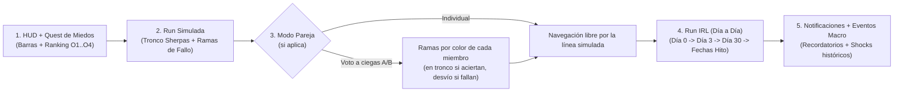

# Propuesta: Sherpas Living Timeline (Simulación + Run IRL)

> **Estado:** Arquitectura definida · **Rama:** `bitlife`  
> **Objetivo:** Resolver el **Paso 3 del asesor** (*Bring the plan to life*) convirtiendo los JSON de Sherpas (`financial-health.json`, `investment-analysis.json` y `persona.md`) en dos líneas temporales conectadas: una **Run Simulada** con ramas de decisión para entender el futuro en <90s, y una **Run IRL** (vida real día a día) con notificaciones de hitos y choques macroeconómicos reales.

---

## 1. Pipeline Completo de la Experiencia

### Fase 1: HUD Financiero + Quest de Miedos (Entrada)
* **Barras de estado estilo BitLife:** Muestra el perfil del hogar y los **5 pilares reales** de `score.pillars` (`Savings & cash flow`, `Debt`, `Investments`, `Liquidity`, `Protection`) junto con las métricas clave, sin abrir con un castigo visual paralizante.
* **Quest inicial de miedos:** La persona (o cada miembro de la pareja) ordena entre 3 y 4 preocupaciones reales extraídas de `persona.md` (`Objective concerns O1..O8`). Ese orden personaliza el foco de las explicaciones y queda registrado para el asesor.
* **Toggle `Plain ↔ Math` permanente:** En cualquier punto, *Plain* explica el impacto en lenguaje cotidiano y *Math* despliega las cifras exactas y la fuente del JSON (`top_moves`, `key_metrics`, `savingsWaterfall`, `taxDragAnalysis`).

---

### Fase 2: La Run Simulada (Tronco Central + Bifurcación de Ramas)
* **El Tronco Central es el camino óptimo de Sherpas:** Avanza desde hoy (`2026`) por los años hito reales del caso (extraídos de `goals.chartGoals`, `persona.md` *Transition alerts* y `score.top_moves`), pintando las estadísticas año a año con `projections.yearly`.
* **Ramificación visual al fallar una decisión:**
  * Si el usuario elige un `top_move` (o `combined_move`), avanza por la **rama central (tronco)** y ve cómo suben sus barras y su `score_after`.
  * Si toma una decisión errónea (no hacer el movimiento o mantener el hábito actual), **nace una rama secundaria desde ese nodo** que viaja directo al año o punto donde el plan sufre las consecuencias:
    * **En casos con agotamiento de liquidez (Michael en `2075`, Samantha en `2053`):** La rama salta al año exacto en que `investable_assets` entra en negativo (`-$38,276` en Michael a los 86; `-$227,414` en Samantha a los 74).
    * **En casos que no quiebran en `yearly` (Weah y Johnson):** La rama muestra el **coste acumulado / brecha de riesgo real** (`$3,240/año` quemados al 18% APR en Weah, tarjeta al 24.9% + `0/20` en protección con `-$2.35M` de brecha de seguro en Johnson, o caída de `UPRO` 3x).
  * **Desplegable de causa raíz (*Por qué falló*):** Al tocar cualquier rama abierta se despliega la explicación exacta cruzando `key_metrics.facts` y `persona.md` (`Tensions T1..T5`), más una mini-pregunta de diagnóstico para que el usuario identifique qué tensión causó el desvío.
  * **Eventos sin alternativa precalculada:** Cuando una meta futura (ej. comprar casa en 2027/2030) no tiene contrafactual calculado por Sherpas, no se inventan números: el nodo muestra el impacto real en `yearly` y permite marcar la alternativa como **pregunta directa para el Advisor Brief**.

---

### Fase 3: Modo Parejas por Votación (Weah y Johnson)
En los hogares con dos titulares (**Timothy & Melanie Weah** y **Daniel & Emily Johnson**), donde `persona.md` (`D4`) detecta perfiles de riesgo distintos (ej. Timothy *Growth* con `UPRO` 3x vs. Melanie *Moderate* con `$150k` en efectivo al `0.09%`):

1. **Votación a ciegas por turnos/móvil:** En cada nodo de decisión, el Miembro A y el Miembro B votan sin ver la elección del otro; al votar ambos, se destapa el resultado.
2. **Trazado por colores en la línea temporal:**
   * Cada miembro tiene su propio color en el mapa temporal.
   * **Si ambos eligen opciones válidas (`top_moves`):** Los dos colores avanzan juntos sobre el **tronco central**, incluso si eligieron movimientos distintos pero válidos.
   * **Si uno (o ambos) elige una opción errónea:** Del nodo sale la **bifurcación con el color de quien tomó esa decisión**, mostrando a dónde lleva su elección y un desplegable que explica con datos de Sherpas por qué esa vía falla o frena el score (`combined_moves: 60 → 78` en Weah; `52 → 60` en Johnson).
3. **Reparto en la Run IRL:** Las acciones del día a día se asignan por responsable (*Owner A / Owner B*) para las tareas individuales y requieren **check conjunto (`2/2`)** en las decisiones familiares grandes. El calendario avanza aunque uno de los dos no marque su parte, acumulando recordatorios dirigidos a quien falte por actuar.

---

### Fase 4: Transición Post-Run → Navegación Libre o "Run IRL"
Al terminar el recorrido simulado, el usuario no pierde su mapa:
1. **Explorar la línea simulada:** Puede moverse libremente hacia atrás y adelante por todos los nodos y ramas para revisar qué decisión abrió cada desvío y consultar su **Advisor Brief** (miedos priorizados, desacuerdos de pareja y escenarios no calculados para pedir al asesor).
2. **Entrar a la "Run IRL" (La línea temporal de la vida real):** Una segunda línea temporal donde **cada paso es un día o hito real** a partir de hoy (`Día 0 → Día 3 → Día 14 → Día 30 → Fechas de transición como Agosto 2027 o Enero 2027`).
   * **El tiempo real avanza siempre (cumplan o no cumplan):** La línea temporal IRL no se congela esperando un check. Los días siguen corriendo; si llega el Día 3 o el Día 30 y el usuario **no ha cumplido** el paso anterior, la tarea se arrastra como *pendiente/vencida* al día actual, se sigue recordando en las siguientes notificaciones y muestra el coste real de posponerla (ej. intereses acumulados al 20%–24.9% APR o días sin cobertura).
   * En cada nodo de la Run IRL se muestra la micro-acción concreta que propone Sherpas según el orden de prioridad de `savingsWaterfall` (16 pasos en `investment-analysis.json`) y `top_moves`.
   * La familia también puede navegar hacia delante y hacia atrás por esta línea IRL para ver qué hizo ayer, qué dejó pendiente, qué toca hoy y qué se desbloquea el mes que viene.

---

### Fase 5: Sistema de Notificaciones (Hitos Día 3/30 + Eventos Macroeconómicos IRL)
La Run IRL se alimenta de dos tipos de notificaciones interactivas que al tocarlas abren el nodo correspondiente en la línea temporal:

| Tipo de Notificación | Cuándo se dispara | Qué muestra y de qué JSON sale |
| :--- | :--- | :--- |
| **1. Notificación de Hito / Insistencia (`Día 0`, `Día 3`, `Día 30`, Fechas clave)** | En los días de seguimiento, antes de una fecha crítica del plan, y **de forma recurrente si el paso anterior sigue sin cumplirse** mientras los días avanzan. | Recuerda la acción exacta pendiente (ej. *"Día 3: ¿Pagaste los $3,500 de Amex al 20%?"*; si en el Día 10 sigue sin marcarse, insiste mostrando lo que sigue costando mantenerla abierta mientras entra el recordatorio del Día 30 del 401(k)). En parejas, avisa al responsable que aún no ha completado su parte. |
| **2. Notificación de Gran Evento Económico IRL (Shock Macro)** | Cuando ocurre una subida de tipos, caída bursátil o pico de volatilidad en el mundo real. | Cruza el evento actual con los **11 eventos históricos reales** de `investment-analysis.json` (`analysis.events` / `perEventDrawdowns`, hasta feb. 2026). Muestra **qué pasó en el evento anterior similar**, cuánto cayó exactamente su cartera real vs. el benchmark (ej. `-10.2%` en Michael recuperado en `62 días`, o el impacto del ETF apalancado `UPRO` en Weah) y por qué mantener el colchón de liquidez evita malvender. |

---

## 2. Respuesta a los 11 Problemas de Sherpas (`README.md`)

| # | Problema detectado por Sherpas | Cómo lo resuelve nuestra arquitectura |
| :-: | :--- | :--- |
| **1** | No ven cómo una decisión hoy cambia su vida décadas después. | Línea temporal horizontal donde cada fallo abre una rama visual directa al año del problema con desplegable explicativo. |
| **2** | Cifras grandes y porcentajes sin sentido (`"$2.37M left"`). | Toggle `Plain ↔ Math` que traduce porcentajes a dólares anuales (`taxDragAnalysis`, intereses APR) y meses de colchón. |
| **3** | Un buen *score* oculta un problema grave (Samantha: `82`, quiebra a los 74). | Las ramas de Samantha saltan directo a `2053` (edad 74, `-$227,414` líquidos) porque tiene `$0` en cuentas de jubilación. |
| **4** | Responde a lo calculable, no al miedo que les quita el sueño. | El Quest inicial ordena sus miedos reales (`O1..O8`) y los no calculados pasan directo al *Advisor Brief*. |
| **5** | Familias ocupadas no leen un plan largo; lo miran en el móvil. | Partida de <90 segundos por nodos visuales y notificaciones cortas en la Run IRL. |
| **6** | Malas noticias hacen mirar hacia otro lado (Michael: `26 critical`). | El tronco central muestra primero que **sí existe un camino viable** (`26 → 62`) antes de explorar las ramas de fallo. |
| **7** | Muerte y seguros se dejan de lado (Johnson: `$250k` vs. `$1.6M+`). | La falta de cobertura (`0/20` en protección) abre una rama de vulnerabilidad familiar en la línea temporal. |
| **8** | Parejas: un plan, dos personas con distinto riesgo (Weah). | Votación a ciegas A/B con trazado por colores sobre el tronco o en ramas separadas + misiones IRL repartidas. |
| **9** | Las dudas llegan el Día 3 o Día 30 cuando ya no hay nadie. | La **Run IRL** convierte el Día 3 y el Día 30 en nodos navegables con notificaciones proactivas. |
| **10** | El plan llega en su fecha, no cuando la familia actúa. | La Run IRL ancla avisos en las fechas reales (`chartGoals` y *Transition alerts*: enero 2027, agosto 2027, 2030). |
| **11** | Demasiadas opciones sin Paso 1 claro ni confirmación. | La Run IRL ordena los pasos según `savingsWaterfall` empezando por una sola acción de 3 minutos en el Día 0. |

---

## 3. Mapa de Datos Reales por Caso (`cases/` — Cero números inventados)

| Caso | Perfil y Score | Nodos y Ramas en la Run Simulada | Run IRL (Día 0 / 3 / 30) y Shocks (`investment-analysis.json`) |
| :--- | :--- | :--- | :--- |
| **Michael Carter** (37, soltero, Austin) | Score **`26`** (`critical`) Pilares: Cash flow `0/25`, Liquidity `4/20`, Protection `4/20` | • **2026:** Umbrella `$1M` (`26→31`), subir growth `74%→88%` (`26→31`). • **2027:** Casa `$550k` (`investable_assets` cae de `$178,717` a `$81,172`, `0 meses` de caja). • **2047:** Jubilarse a los 58 (`26→62` bajando retiro a `$10,300/año`). • **Rama de fallo:** Salta a **2075 (edad 86)** con `-$38,276` líquidos. | • **Día 0/3:** Pagar Amex `$3,500` (20% APR) con los `$27,000` de banco. • **Día 30:** Subir 401(k) (`+$7,500` de margen = `$1,800/año` ahorro fiscal) y revisar bono `JNK` (`$527/año` *tax drag*). • **Shock macro:** Caída máx. `-10.2%` recuperada en `62 días`. |
| **Samantha Lewis** (47, 2 hijos: 18 y 16) | Score **`82`** (`strong`) Engañoso: `$0` en cuentas de jubilación | • **2026:** Seguro de hogar (`82→84`), bajar concentración en `VTI` de `39%→25%` (`82→83`), ajustar growth `85%→80%` (`82→83`). • **2027–2030:** Universidad hijos (`$50k` c/u) + casa de `$500k` en 2030. • **Rama de fallo:** Salta a **2053 (edad 74)** con `-$227,414` líquidos (y `net_worth` negativo en 2070). | • **Día 0/3:** Confirmar póliza de hogar y del Porsche Cayenne. • **Día 30:** Abrir/aportar los `$24,500` de margen en 401(k) + `$4,400` HSA y corregir los `$3,032/año` de *tax drag* en cuenta sujeta a impuestos. |
| **Timothy & Melanie Weah** (40 y 38, 2 hijos: 6 y 3) | Score **`60`** (`vulnerable`) Pareja desalineada: Growth vs. Moderate | • **Voto pareja (2026):** Pagar tarjeta `$18k` al 18% (`60→62`), cubrir brecha seguro de vida `$1.1M` + umbrella `$1M`. **Juntos (`combined_moves`) suben `60 → 78`.** • **Rama de fallo:** No quiebran en `yearly` (`$16.1M` en 2079), pero la rama muestra los **`$3,240/año` perdidos al 18%** mientras tienen `$150,800` al `0.09%`, más el riesgo de `UPRO` (3x). | • **Owner Melanie (Día 3):** Liquidar los `$18,000` de tarjeta (18% APR) usando el exceso de efectivo. • **Owner Timothy (Día 14/30):** Reducir exposición apalancada `UPRO` y activar ahorro fiscal 401(k) (`$5,760/año`) + 529. • **Shock macro:** Alerta de caída amplificada 3x en `UPRO` vs. eventos de 2023–2026. |
| **Daniel & Emily Johnson** (44 y 42, 2 hijos: 11 y 9) | Score **`52`** (`vulnerable`) Protection `0/20`, caja `1.4 meses` | • **Voto pareja (2026):** Subir seguro de vida `+$1.166M` (`52→57`), añadir umbrella `$1M` (`52→56`), redirigir `$15,032/año` a ahorro (`52→55`). **Combinados suben `52 → 60`.** • **Rama de fallo:** Muestra la desprotección familiar (`-$2.35M` brecha total de vida) y la tarjeta de `$18,000` al **24.9% APR** mientras ahorran `$0` para jubilación. | • **Check conjunto (Día 3):** Frenar desvío a brokerage/529 para atacar la tarjeta al 24.9% y pedir cotización de seguro de vida. • **Día 30:** Activar aportación a 401(k) (actualmente `$0`, con `$11,760/año` de ahorro fiscal potencial). |

---

## 4. Fundamentación Psicológica: Motor de Desbloqueo Conductual (*Behavioral Translation Engine*)

En lugar de ser solo un visor de datos, la arquitectura funciona como un **motor de traducción conductual** donde cada pieza del pipeline neutraliza un sesgo cognitivo concreto documentado en economía conductual:

### 4.1. Sesgos de Clasificación del Dinero (Por qué toman malas decisiones con sus cuentas)

| Sesgo Psicológico | Cómo sabotea al cliente en los casos de Sherpas | Qué mecánica de nuestra app lo desbloquea |
| :--- | :--- | :--- |
| **Contabilidad Mental** (*Mental Accounting* — R. Thaler) | Separan en "cajones mentales" el ahorro intocable y la deuda cara: **Weah** guarda `$150,800` al `0.09%` mientras paga un `18%` en su tarjeta de `$18,000`; **Johnson** ahorra `$26,000/año` en cuentas varias mientras arrastra `$18,000` al `24.9%`. | **Rama "Cubo Agujereado" + Desplegable de Flujo Neto:** En la línea temporal, no pagar la tarjeta abre una rama que junta ambos cajones en una sola cifra (*"Tu efectivo rinde ~$135/año, pero tu tarjeta quema $3,240/año: pagas $3,105 netos al año por tener ambos separados"*). |
| **Efecto Halo / Ceguera de Indicador Único** (*Single-Metric Fallacy & Halo Effect*) | Un indicador global en verde hace asumir que todo está sano: **Samantha Lewis** ve un `82/100 (Strong)` y no percibe que tiene `$0` en cuentas de jubilación. | **HUD desglosado + Salto al Punto Ciego (2053):** La interfaz no se queda en el `82`; la rama de jubilación salta directo a los **74 años (`2053`)**, donde sus activos líquidos caen a `-$227,414`. |
| **Ilusión de Riqueza Inmobiliaria** (*House-Rich, Cash-Poor Illusion*) | Confunden `net_worth` con dinero líquido para vivir: **Michael** (`$2.57M` de patrimonio en 2075 pero `-$38,276` líquidos), **Samantha** (`$900k` en ladrillo sobre `$1.39M`) y **Johnson** (`$750k` de casa con solo `$190k` de capital libre). | **Separación visual `Investable Assets` vs. `Net Worth`:** En las ramas de quiebra y en la gráfica de `yearly`, la línea principal traza `investable_assets` (dinero para pagar facturas), dejando claro cuándo el patrimonio solo son paredes ilíquidas. |

### 4.2. Sesgos Temporales (El choque entre el "Yo de hoy" y el "Yo del futuro")

| Sesgo Psicológico | Cómo sabotea al cliente en los casos de Sherpas | Qué mecánica de nuestra app lo desbloquea |
| :--- | :--- | :--- |
| **Descuento Hiperbólico / Sesgo del Presente** (*Present Bias*) | El deseo inmediato pesa mucho más que un déficit lejano: **Michael** prioriza comprar una casa de `$550k` en enero de 2027 (vaciando sus inversiones de `$178,717` a `$81,172` y dejando `0 meses` de caja) sin ver cómo choca con jubilarse a los 58. | **Bifurcación instantánea en la línea temporal:** Al tomar la decisión en `2026/2027`, la rama conecta en el mismo plano visual el presente con el impacto en `2047` y `2075`, eliminando la distancia temporal. |
| **Desconexión con el "Yo Futuro"** (*Future-Self Continuity Gap* — H. Hershfield) | El cerebro trata al "yo de 85 años" como a un extraño; frases como *"te faltarán $32,439 a los 85"* o *"te quedarán $2.37M"* no generan reacción. | **Mecánica de progreso en primera persona (`Age 37 → Age 58 → Age 86`) + Toggle `Plain ↔ Math`:** El usuario vive su propia línea temporal cumpliendo años y traduce millones abstractos a meses de vida cubiertos. |
| **Falacia de Planificación y Costes Ocultos** (*Planning Fallacy & Hidden Cost Neglect*) | **Michael** compara `$2,800/mes` de alquiler con `$3,015/mes` de hipoteca e ignora `$5,665/año` de impuestos, `$2,832.50/año` de seguro y `$9,464` de gastos de cierre; **Samantha** planea otra compra de `$500k` en 2030. | **Desplegable del Nodo de Transición (2027 / 2030):** Antes de decidir en el nodo de vivienda, el desplegable desglosa el coste total real de propiedad frente a la liquidez disponible (`persona.md` *Transition alerts*). |

### 4.3. Sesgos Emocionales y de Defensa (Por qué el cliente cierra el informe)

| Sesgo Psicológico | Cómo sabotea al cliente en los casos de Sherpas | Qué mecánica de nuestra app lo desbloquea |
| :--- | :--- | :--- |
| **Efecto Avestruz** (*Ostrich Effect*) | Evitar información que hace sentir fracasado: **Michael** ahorra el `23.9%` de su sueldo (`$43,000/año`), pero abrir con un `26/100 Critical` en rojo le hace cerrar el informe. | **Reframing Positivo + Tronco Central como Camino Viable:** El HUD reconoce primero su esfuerzo de ahorro (`23.9%`) y el tronco central le demuestra que reordenando sus piezas sube de `26 → 62` sin dejar de ser él. |
| **Sesgo de Optimismo e Invulnerabilidad** (*Optimism Bias & Mortality Salience*) | Posponer seguros porque nadie quiere pensar en morir o sufrir una demanda: **Johnson** tiene `0/20` en protección (`-$2.35M` de brecha de vida con 2 hijos) y **Weah** tiene `-$1.1M` de brecha y `$0` en *umbrella*. | **Quest de Miedos + Nodos de Escudo Familiar:** En lugar de hablar de muerte en abstracto, la barra de `Protection` y el nodo de `top_moves` lo plantean como blindar los ingresos de los hijos (`52 → 60` en Johnson). |
| **Priorización Emocional Invertida** (*Síndrome de la Mascarilla de Oxígeno*) | Los padres priorizan por culpa la universidad de los hijos antes que su propia jubilación: **Johnson** mete `$8,000/año` al 529 de Oliver y Sophia pero `$0` al 401(k) (perdiendo `$11,760/año` en ahorro fiscal); **Samantha** compromete `$100k` de universidad con `$0` en cuentas de retiro. | **Desplegable de Tensión (`T5` en Johnson / `O1` en Samantha) + Orden del `savingsWaterfall`:** La rama explica por qué desatender el 401(k) traslada el problema a los hijos más adelante y prioriza los pasos según la cascada óptima de Sherpas. |

### 4.4. Sesgos de Acción, Inercia y Pareja (Por qué no hacen nada tras la reunión)

| Sesgo Psicológico | Cómo sabotea al cliente en los casos de Sherpas | Qué mecánica de nuestra app lo desbloquea |
| :--- | :--- | :--- |
| **Parálisis por Análisis y Sobrecarga** (*Choice Overload / Hick's Law*) | En **Weah** y **Johnson** (`T1`), 6 metas urgentes compiten a la vez por los mismos `$15,032` de flujo de caja libre; al no saber por cuál empezar, no ejecutan ninguna. | **Secuenciación Día a Día en la Run IRL:** En vez de volcar las 16 filas de `savingsWaterfall` de golpe, la Run IRL entrega **un único paso accionable en el Día 0** (3 minutos) y desbloquea el siguiente en el Día 3 y Día 30. |
| **Sesgo de Statu Quo y Curva del Olvido** (*Status Quo Bias & Ebbinghaus Curve*) | A los 3 o 30 días la motivación inicial desaparece y la fricción administrativa gana. | **Run IRL con avance implacable del tiempo + Notificaciones de Insistencia:** Los días avanzan cumplan o no; si no marcan el paso en el Día 3, la tarea se arrastra como vencida mostrando el coste diario de la inercia y vuelve a notificar. |
| **Aversión a la Pérdida y Sesgo de Recencia** (*Loss Aversion & Recency Bias* — Kahneman & Tversky) | **Melanie Weah** teme invertir su efectivo (`$150k` al `0.09%`), mientras **Timothy** confía en exceso en su ETF apalancado 3x (`UPRO`) tras el último ciclo alcista. | **Notificaciones de Eventos Económicos IRL (`analysis.events`):** Compara cada susto del mercado con los **11 shocks históricos reales** (2023–2026), mostrando la caída y recuperación real (`62 días` en Michael) frente al riesgo real de un 3x apalancado. |
| **Veto Silencioso y Silos en Pareja** (*Couples Veto & Role Siloing*) | En **Weah** y **Johnson**, ellos son *Growth (4)* y ellas *Moderate (3)* (y en Johnson, Emily gestiona el ahorro y Daniel las deudas); un plan que hable solo a uno es bloqueado por el otro. | **Votación a ciegas A/B con ramas por color + Reparto *Owner A / Owner B* en la Run IRL:** Visibiliza dónde coinciden sobre el tronco y dónde se bifurca cada uno, y reparte las misiones IRL según quién gestiona cada cuenta. |

