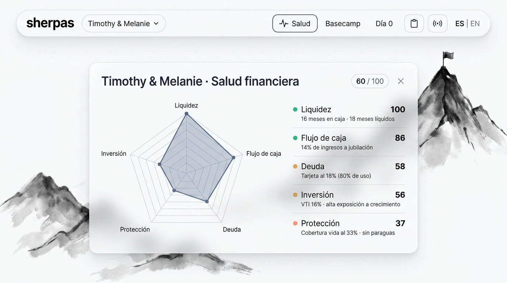
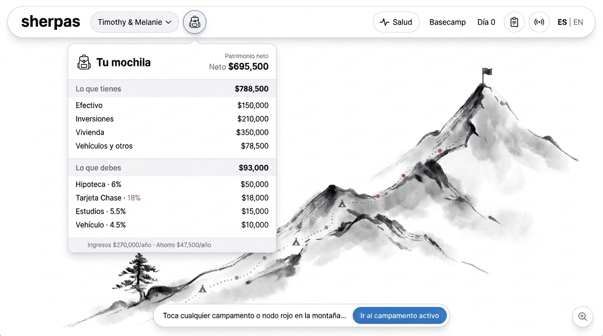

# Especificación Frontend: `Salud` (Pentágono) y `Tu mochila` (Balance Real)

> **Propósito:** Guía lista para que un agente/LLM implemente estas dos funcionalidades en el frontend de *Sherpa Basecamp* manteniendo estrictamente la estética minimalista de tinta china (*sumi-e*) de la montaña y **usando exclusivamente datos reales de `financial-health.json`** (cero datos inventados).

---

## 0. Reglas innegociables de diseño y datos

1. **Cero datos inventados:** Cada cifra, porcentaje y texto de contexto debe salir directamente del `financial-health.json` del caso activo (`cases/<case>/financial-health.json` o el payload equivalente servido por la API).
2. **Solo lectura (estático):** Ninguna de las dos vistas lleva simuladores, toggles internos, botones de acción ni recomendaciones (`top_moves`). Son paneles puramente informativos para consultar estado y cifras reales sin ruido.
3. **Estética coherente con la montaña *sumi-e*:**
   - Lienzo blanco puro (`#FFFFFF`), tarjetas blancas/translúcidas (`rgba(255, 255, 255, 0.96)` con `backdrop-filter: blur(8px)`), bordes finos (`1px solid #E5E7EB`), sombras muy suaves (`0 12px 32px rgba(15, 23, 42, 0.08)`), tipografía sans-serif limpia (`Inter` / sistema).
   - **Sin barras de progreso corporativas** ni cajas rojas de alarma (*"Crítico"*). Colores de estado suaves: verde esmeralda (`#2E9E75`), ámbar cálido (`#D4A04A`), coral suave (`#E07A68`) y tinta azul-grisácea (`#4A5D75`) para el polígono del radar.
4. **Soporte bilingüe (`ES | EN`):** Todos los títulos y etiquetas deben respetar el selector de idioma `ES | EN` de la barra superior.

---

## 1. Cambios en la barra superior (`TopBar`)

### Qué se elimina
- **Quitar las 5 barritas mini con siglas** (`CF`, `DB`, `IN`, `LQ`, `PR`) que estaban al lado del selector de usuario (`Michael v` / `Timothy & Melanie v`).

### Qué se añade
1. **Izquierda (inmediatamente a la derecha del selector de caso `Timothy & Melanie v`):**
   - **Botón circular de Mochila (`Tu mochila`):**
     - Forma: círculo perfecto (`36px × 36px` o `38px × 38px`), fondo blanco `#FFFFFF`, borde fino `1px solid #D1D5DB` (en estado activo/abierto, borde más marcado `#475569` y sombra suave).
     - Icono interior: **mochila minimalista de trazo fino negro (`stroke-width: 1.6`, sin relleno)**, con exactamente la misma estética geométrica limpia que el icono de tienda de campaña de la app.
     - Tooltip / `aria-label`: `"Tu mochila · Balance real"` (`"Your pack · Real balance"` en EN).
2. **Derecha (a la izquierda del botón `Basecamp`):**
   - **Botón pill `Salud`:**
     - Forma: pill redondeada (`border-radius: 9999px`), fondo blanco, borde fino `1px solid #D1D5DB` (en estado activo, borde `#1E293B`).
     - Contenido: icono de **signos vitales / pulso (`Activity`)** de trazo fino + texto **`Salud`** (`Health` en EN).

Orden final de la barra superior:
`sherpas` | `[Selector caso v]` `[🎒 Botón circular]` ... *(espacio libre)* ... `[📈 Salud]` `[Basecamp]` `Día 0` `[Portapapeles]` `[Radio]` `[ES | EN]`

---

## 2. Funcionalidad 1: Modal `Salud` (Pentágono Topográfico de 5 Pilares)

### Comportamiento
- Al pulsar **`Salud`**, se abre un **modal centrado** sobre un fondo suavemente atenuado (`rgba(255, 255, 255, 0.55)` + `backdrop-filter: blur(2px)`) para que la montaña *sumi-e* siga respirando detrás.
- Si el desplegable `Tu mochila` estaba abierto, se cierra automáticamente.
- Se cierra con el botón `×`, tecla `Escape` o clic fuera del modal.
- **No mostrar `score.top_moves` ni botones interactivos dentro del modal.**

### Estructura visual (ancho máx. ~`740px`, padding `28px–32px`, `border-radius: 20px`)

1. **Cabecera:**
   - Izquierda: `{Nombre del caso} · Salud financiera` (en EN: `{Case name} · Financial health`).
   - Derecha: badge pill neutro `{score.published_score} / 100` (fondo `#F8FAFC`, borde `1px solid #E2E8F0`, número en negrita `#0F172A`, `/ 100` en `#64748B`) + botón de cierre `×`.

2. **Cuerpo en 2 columnas equilibradas** (en móvil se apilan en 1 columna: pentágono arriba, lista abajo):

   - **Columna izquierda — Gráfico Radar Pentagonal (SVG puro):**
     - **5 anillos concéntricos pentagonales** (niveles `20`, `40`, `60`, `80`, `100`) con líneas finas gris claro (`#E2E8F0`, `stroke-width: 1`), evocando curvas de nivel topográficas.
     - **5 ejes radiales** desde el centro hacia cada vértice, con las etiquetas limpias fuera de cada vértice (en sentido horario desde arriba):
       1. Arriba: `Liquidez` (`Liquidity`)
       2. Arriba-derecha: `Flujo de caja` (`Cash flow`)
       3. Abajo-derecha: `Deuda` (`Debt`)
       4. Abajo-izquierda: `Protección` (`Protection`)
       5. Arriba-izquierda: `Inversión` (`Investments`)
     - **Polígono de datos:** construido directamente con los `score` (`0..100`) de cada pilar en `score.pillars`.
       - Relleno: `rgba(74, 93, 117, 0.28)` (azul-tinta traslúcido).
       - Contorno: `#4A5D75`, `stroke-width: 1.75`.
       - Vértices: círculos de `r="3.5"` en `#4A5D75`.

   - **Columna derecha — Lista limpia de los 5 pilares (sin barras de progreso):**
     - Ordenados de mayor a menor `score` (para mostrar primero las fortalezas y reducir el miedo).
     - Cada ítem separado por un divisor fino (`1px solid #F1F5F9`) y compuesto por:
       - **Línea principal:** puntito circular de `8px` según el score (`>= 75`: verde `#2E9E75`, `45–74`: ámbar `#D4A04A`, `< 45`: coral suave `#E07A68`) + nombre del pilar + valor `pillar.score` alineado a la derecha en negrita.
       - **Línea secundaria (interpretabilidad real):** 1 sola línea corta en gris (`#64748B`, `12px–13px`) con el dato objetivo extraído de `score.explainer` / `key_metrics` del caso (sin inventar frases subjetivas).

### Mapeo de datos desde `financial-health.json`

| Pilar en JSON (`score.pillars[].pillar`) | Etiqueta ES | Etiqueta EN | Fuente del dato de interpretabilidad (1 línea) |
| :--- | :--- | :--- | :--- |
| `Liquidity and emergency fund` | `Liquidez` | `Liquidity` | Meses de caja / liquidez de `score.explainer` (sección `## Liquidity`) o `key_metrics.ratios` |
| `Savings and cash flow` | `Flujo de caja` | `Cash flow` | Tasa de ahorro o tasa de retirada vs. 4% sostenible de `score.explainer` (`## Cash flow`) |
| `Debt` | `Deuda` | `Debt` | Estado de pagos y tarjeta con mayor APR de `score.explainer` (`## Debt`) / `debtManagement` |
| `Investments` | `Inversión` | `Investments` | Concentración / % crecimiento vs. objetivo de `score.explainer` (`## Investing`) |
| `Insurance and protection` | `Protección` | `Protection` | Ratio de cobertura de vida (%) y existencia de seguro paraguas de `score.explainer` (`## Protection`) |

Ejemplo real con **Timothy & Melanie Weah** (`published_score: 60`):
- `Liquidez` — `100` → `16 meses en caja · 18 meses líquidos`
- `Flujo de caja` — `86` → `14% de ingresos a jubilación`
- `Deuda` — `58` → `Tarjeta al 18% (80% de uso)`
- `Inversión` — `56` → `VTI 16% · alta exposición a crecimiento`
- `Protección` — `37` → `Cobertura vida al 33% · sin paraguas`

---

## 3. Funcionalidad 2: Desplegable `Tu mochila` (Balance Real)

### Comportamiento y posicionamiento
- Al pulsar el **botón circular de mochila** junto al selector de usuario, se abre un **desplegable flotante (popover) anclado arriba a la izquierda**, justo debajo del botón, ocupando únicamente el cielo blanco libre de la esquina superior izquierda.
- **Muy importante:** **NO debe ser un panel lateral hasta abajo de la pantalla.** Debe ser compacto (`width: ~330px–360px`, altura automática según contenido, máx. ~`440px`), dejando siempre visibles el pino, la ladera, los campamentos de la montaña y la barra inferior.
- Incluye una pequeña flecha/pico superior apuntando al botón circular de mochila.
- Si el modal `Salud` estaba abierto, se cierra automáticamente. Se cierra al volver a pulsar el botón, con `Escape` o al hacer clic fuera.

### Estructura visual (estático, tipografía editorial limpia)

1. **Cabecera del desplegable:**
   - Izquierda: icono fino de mochila (`18px`) + título **`Tu mochila`** (`Your pack` en EN).
   - Derecha: micro-etiqueta `Patrimonio neto` (`Net worth`) arriba y **`Neto $695,500`** debajo en negrita (desde `key_metrics.netWorthStatement.netWorth.total`).

2. **Bloque 1 — `Lo que tienes` (`What you own`):**
   - Cabecera de bloque en banda muy suave (`#F8FAFC`): `Lo que tienes` a la izquierda y total `assets.total` en negrita a la derecha.
   - Filas clave–valor (nombre a la izquierda, importe en `$` alineado a la derecha con `font-variant-numeric: tabular-nums`), tomadas de `key_metrics.netWorthStatement.assets.items`:
     - `Efectivo` ← `Cash account`
     - `Inversiones` ← `Investment account`
     - `Vivienda` ← `Real estate`
     - `Vehículos y otros` ← suma de `Vehicle` + `Other asset` + cualquier otra categoría con `total > 0` (`Business`, `Stock compensation`, `Annuity`, `Insurance (Cash value)`).
     - **Omitir filas con `total === 0`** para mantener la tarjeta compacta y limpia.

3. **Bloque 2 — `Lo que debes` (`What you owe`):**
   - Cabecera de bloque en banda suave (`#F8FAFC`): `Lo que debes` a la izquierda y total `liabilities.total` en negrita a la derecha.
   - Filas tomadas de `key_metrics.debtManagement.listOfDebts` (saltando la fila 0 de cabeceras `["Name", "Type", "Balance", "Interest rate", ...]`) filtrando únicamente las deudas con **`Balance > 0`**, ordenadas de mayor a menor saldo:
     - Formato por fila: `{Nombre corto} · {Interest rate * 100}%` a la izquierda | `${Balance}` a la derecha.
     - **Detalle visual:** si el tipo de interés es alto (`>= 0.15`, es decir `>= 15%`, como las tarjetas al `18%`, `20%` o `24.9%`), mostrar solo el porcentaje (`18%`) en coral suave (`#C86455`) para que salte a la vista sin meter alertas agresivas.
     - **Caso borde sin deudas (ej. Samantha Lewis, `liabilities.total === 0`):** mostrar una única línea discreta en gris: `Sin deudas pendientes` (`No outstanding debt`) con `$0`.

4. **Pie del desplegable (franja gris muy clara `#F8FAFC`):**
   - Una sola línea centrada o alineada a la izquierda en texto pequeño (`12px`, `#64748B`):
     - `Ingresos ${inflows.total}/año · Ahorro ${Savings}/año`
     - Fuentes exactas:
       - `inflows.total` → `key_metrics.cashflowStatement.inflows.total`
       - `Savings` → ítem `"Savings"` dentro de `key_metrics.cashflowStatement.outflows.items` (si no existe o es `0`, mostrar solo `Ingresos`).

---

## 4. Checklist de verificación para el LLM implementador

- [ ] Las 5 barritas `CF`, `DB`, `IN`, `LQ`, `PR` ya no aparecen junto al selector de usuario.
- [ ] El botón circular de mochila está junto al selector de usuario y usa icono de trazo fino negro dentro de círculo blanco con borde gris claro.
- [ ] El desplegable `Tu mochila` se abre en el espacio superior izquierdo sin tapar el pino ni la ladera de la montaña.
- [ ] El botón `Salud` (con icono de pulso) está junto a `Basecamp` y abre el modal centrado con el pentágono SVG de 5 anillos y los 5 pilares con puntitos de color (sin barras de progreso ni `top_moves`).
- [ ] Ambos paneles funcionan dinámicamente con los 4 casos reales (`michael-carter`, `samantha-lewis`, `timothy-melanie-weah`, `daniel-emily-johnson`), incluyendo el caso sin deudas de Samantha (`$0`).
- [ ] Ambos paneles se traducen correctamente con el toggle `ES | EN` y no se superponen entre sí (abrir uno cierra el otro).
